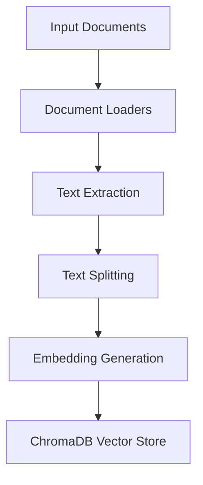
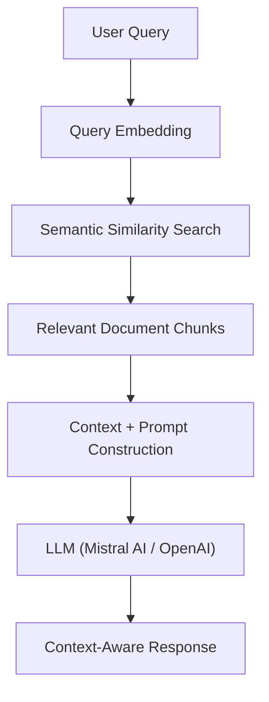

# 📚 CourseMate AI — Intelligent Document Question Answering System

**CourseMate AI** is an AI-powered document intelligence application built using Retrieval-Augmented Generation (RAG). It enables users to interact with documents through natural language queries and receive context-aware responses based on the information contained in the provided documents.

By combining Large Language Models (LLMs), semantic search, vector databases, and document processing, CourseMate AI makes it easier to retrieve, understand, and explore information from large collections of documents.

---

## ✨ Key Features

- **📄 Document Loading:** Supports loading and processing documents such as PDF, DOCX, and TXT files.
- **✂️ Intelligent Text Chunking:** Splits large documents into smaller, manageable chunks while preserving contextual information.
- **🧠 Semantic Embeddings:** Converts text into numerical vector representations to capture semantic meaning.
- **🗄️ Vector Database:** Uses ChromaDB to store document embeddings and retrieve relevant information efficiently.
- **🔍 Semantic Search:** Finds relevant document sections based on the meaning of user queries rather than exact keyword matches.
- **💬 Context-Aware Question Answering:** Uses LLMs to generate responses grounded in retrieved document content.
- **⚡ Retrieval-Augmented Generation:** Combines document retrieval with generative AI to provide relevant and informative answers.

---

## 🏗️ System Architecture

CourseMate AI follows a Retrieval-Augmented Generation architecture consisting of two major workflows: document ingestion and query processing.

### 1. Document Ingestion Pipeline



### 2. Query Processing Pipeline



### How It Works

1. **Document Loading:** Loads source documents using LangChain document loaders.
2. **Text Splitting:** Divides extracted content into smaller chunks using text splitters.
3. **Embedding Generation:** Converts document chunks into vector representations.
4. **Vector Storage:** Stores embeddings and associated metadata in ChromaDB.
5. **Query Embedding:** Converts the user's question into a vector representation.
6. **Retrieval:** Retrieves semantically relevant document chunks from the vector database.
7. **Response Generation:** Supplies the retrieved context to an LLM to generate a relevant answer.

---

## 🛠️ Tech Stack

| Technology | Purpose |
|---|---|
| Python | Core programming language |
| LangChain | RAG pipeline and component integration |
| ChromaDB | Vector database and similarity search |
| Mistral AI | Embedding and/or language model integration |
| OpenAI | Large Language Model integration |
| Hugging Face | Embedding model ecosystem |
| PyPDF | PDF document processing |
| Unstructured | Document extraction and processing |
| Python-dotenv | Environment variable management |

---

## 📂 Project Structure

The project is organized around document loading, embedding generation, vector storage, and retrieval.

```text
CourseMate-AI/
│
├── document_loaders/       # Document loading and processing
│   ├── research_paper.pdf
│   └── FinMate_Camera_Ready_Paper.docx
│
├── vector_store/            # ChromaDB storage (if persisted)
│
├── main.py                  # Application entry point
├── requirements.txt         # Project dependencies
├── .env                     # API credentials
├── .gitignore               # Git ignored files
└── README.md                # Project documentation
```

*Adjust the filenames and folders to match the actual repository structure.*

---

## 🚀 Getting Started

### 1. Clone the Repository

```bash
git clone https://github.com/himanshuwalde/CourseMate-AI.git
```

```bash
cd CourseMate-AI
```

### 2. Create a Virtual Environment

```bash
python -m venv .venv
```

Activate the environment:

**Windows (PowerShell):**

```powershell
.venv\Scripts\Activate.ps1
```

**macOS / Linux:**

```bash
source .venv/bin/activate
```

### 3. Install Dependencies

```bash
pip install -r requirements.txt
```

### 4. Configure Environment Variables

Create a `.env` file in the project root directory.

```env
OPENAI_API_KEY=your_openai_api_key
MISTRAL_API_KEY=your_mistral_api_key
```

Add only the credentials required by the selected model and embedding integrations.

API resources:

- [OpenAI Platform](https://platform.openai.com/)
- [Mistral AI Console](https://console.mistral.ai/)

### 5. Run the Application

Run the project's configured entry-point script:

```bash
python main.py
```

*Replace `main.py` with the actual application entry point if your repository uses a different filename.*

---

## 🧩 Core RAG Components

### Document Loaders
LangChain document loaders extract text and metadata from different file formats, including PDF and Word documents.

### Text Splitters
Recursive character-based text splitting divides lengthy documents into smaller chunks suitable for embedding and retrieval.

### Embedding Models
Embedding models transform textual content into high-dimensional vectors, enabling semantic similarity comparisons.

### ChromaDB
ChromaDB stores document embeddings and metadata and provides similarity-based retrieval of relevant document chunks.

### Large Language Models
Mistral AI and OpenAI models can use the retrieved document context to generate natural-language responses.

---

## 🎯 Project Objectives

- Understand and implement Retrieval-Augmented Generation architecture.
- Build practical applications using LangChain and Large Language Models.
- Explore semantic search and vector database integration.
- Process and retrieve information from unstructured documents.
- Improve the relevance of LLM responses through document-grounded retrieval.
- Develop practical experience with modern Generative AI technologies.

---

## 🔮 Future Enhancements

- Develop an interactive chat interface for document-based conversations.
- Support multiple document uploads and collections.
- Implement conversational memory for follow-up questions.
- Introduce hybrid search combining keyword and semantic retrieval.
- Add source citations and document page references to responses.
- Implement advanced retrieval strategies and reranking.
- Add document summarization and automated question generation.

---

## 👨‍💻 Author

**Himanshu Walde**

Computer Science & Engineering | AI & Machine Learning

- GitHub: [@himanshuwalde](https://github.com/himanshuwalde)
- LinkedIn: [Himanshu Walde](https://www.linkedin.com/in/himanshu-walde-20b716290/)

---

## 📄 License

Developed for educational and learning purposes.

---

⭐ If you find this project interesting, consider giving the repository a star!